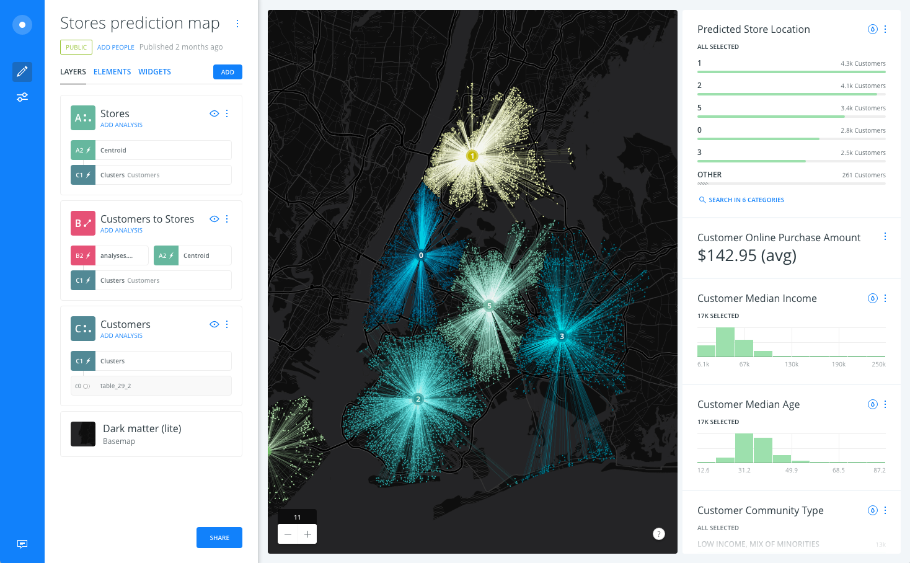
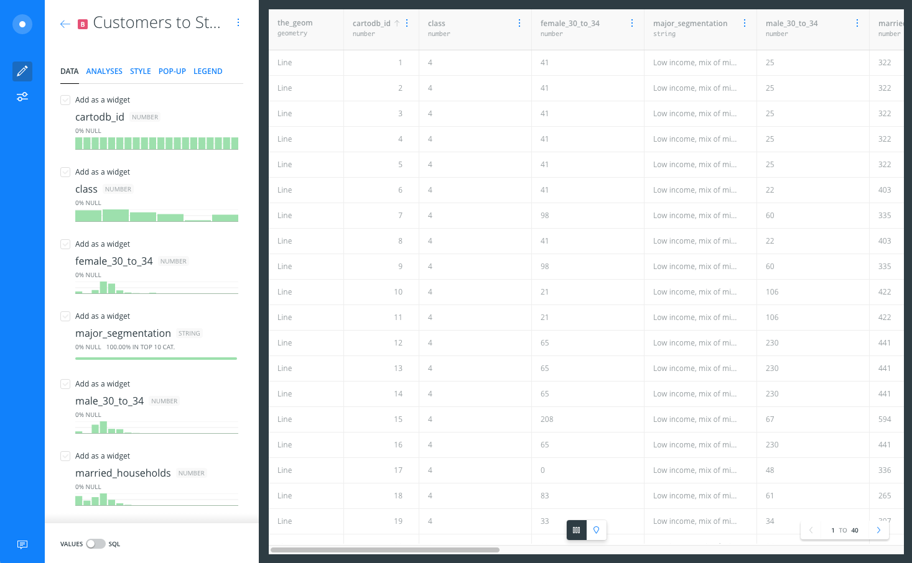

# CARTO

This project starts as a fork of CartoDB **v4.44.0**, the legacy version of the open-source CARTO platform. It is the web application for uploading geospatial data, styling maps, and building location applications on your own server.

You can upload geospatial data (Shapefiles, GeoJSON, and other formats), keep it public or private, browse it as a dataset or on a map, query it with SQL, and style it with CartoCSS. The same data can be reached through the CARTO APIs or exported to a file.

## Documentation

Install, configuration, and platform guides (original CARTO documentation):

- [CARTO documentation](http://cartodb.readthedocs.org/en/latest/)
- [Installation](http://cartodb.readthedocs.org/en/latest/install.html)
- [CARTO platform APIs](https://docs.carto.com/#cartodb-platform)

Notes on this repo:

- [Upgrade](UPGRADE)
- [Testing](TESTING.md)
- [In-repo docs](doc/README.md)

Upgrade notes for Windshaft and the SQL API are in the original documentation.
